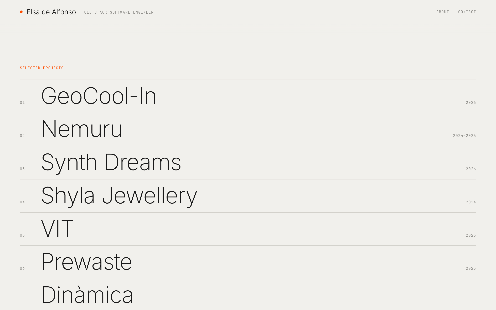

<div align="center">

# Elsa de Alfonso · Portfolio

**A single-screen portfolio with a project list that reacts to the cursor, edited from a headless CMS.**

[**Live demo →**](https://elsadealfonso.vercel.app)


<br>

<a href="https://elsadealfonso.vercel.app">
  
</a>

</div>

## What it is

My personal portfolio, designed to fit on one screen and get out of the way of the work.

- **A list, not a grid.** Projects are large typographic rows. Hovering one nudges its title and opens a preview window (video or screenshot) that follows the cursor, with its key technologies.
- **Click for the details.** A popup with what the project is, what I built, the full stack and the links, over a blurred, slowly drifting version of its screenshot.
- **Filter by technology.** Click any tag in a popup to list only the projects that use it.
- **About and Contact** are popups too. The contact form sends straight to my inbox.
- **Works without a hover.** On touch screens there is no cursor window: each row shows its technologies and a thumbnail instead.
- **Edited without touching code.** Projects, technologies and the About text live in Sanity Studio, embedded at `/studio`.
- **No cookies, no analytics,** so no banner.

## Tech stack

| Area | Tools |
| --- | --- |
| Framework | Next.js 16 (App Router, Cache Components), React 19, TypeScript |
| Content | Sanity (GROQ, embedded Studio, drag-to-reorder list, shared `technology` documents) |
| Styling | Plain CSS with variables, Inter and JetBrains Mono |
| Forms | Web3Forms (client-side, no backend) |
| Hosting | Vercel, deployed on every push to `main` |

No UI kit and no animation library: every transition is CSS.

## What I built

Everything: design, front end and content model.

- **Interaction design:** entrance animation (lines draw, titles rise in a stagger), the cursor-following preview window, the popup choreography (the page blurs first, then the backdrop fades in) and a backdrop that drifts along a very slow five-point star.
- **Content model in Sanity:** projects, an About document, and technologies as shared documents so "Swiper" and "Swiper.js" can never both exist. Case studies and internal products (no public link, generic name) are supported, with a generic blurred placeholder instead of real screenshots.
- **Responsive behaviour:** a separate touch layout, a header that fades over the list when scrolling, and filtering that scrolls back to the top.
- **Delivery:** cached GROQ queries, media sized for the web, and a deploy pipeline on Vercel.

## Run it locally

You need Node.js 20 or later.

```bash
git clone https://github.com/edealfonso/portfolio.git
cd portfolio
npm install
npm run dev
```

Open [http://localhost:3000](http://localhost:3000). With no configuration it shows sample projects, so it works out of the box.

To connect your own content:

```bash
cp .env.local.example .env.local
```

| Variable | What it is |
| --- | --- |
| `NEXT_PUBLIC_SANITY_PROJECT_ID` | Your Sanity project ID. |
| `NEXT_PUBLIC_SANITY_DATASET` | Dataset name, `production` by default. |
| `NEXT_PUBLIC_WEB3FORMS_KEY` | Access key from [web3forms.com](https://web3forms.com). Without it the contact form's send button is disabled. |

Then edit your content at [http://localhost:3000/studio](http://localhost:3000/studio). Add `http://localhost:3000` to your project's CORS origins in Sanity first.

| Command | What it does |
| --- | --- |
| `npm run dev` | Development server |
| `npm run build` | Production build |
| `npm run start` | Serve the production build |
| `npm run lint` | ESLint |

## Project structure

```
app/(site)/        The site: page.tsx (loads data), Portfolio.tsx (client), globals.css
app/(studio)/      Sanity Studio embedded at /studio
sanity/            Schema, GROQ query and environment
sanity.config.ts   Studio configuration
```

## Contact

[elsadealfonso.vercel.app](https://elsadealfonso.vercel.app)
